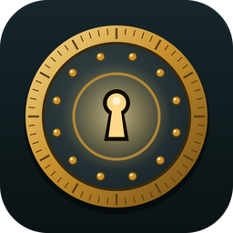

# Keyhole

**The daily word vault.** Crack a new vault every day: three locks, a 4-, 5- and 6-letter word, and 15 guesses to share between them.

## How to play

- Every guess turns the tumblers. A letter **Clicks** (gold) when it's in the right spot, **Wiggles** (copper) when it's in the word but somewhere else, and stays **Silent** (dark) when it isn't in the word.
- All three locks share **15 guesses**. Guesses you save on one lock carry over to the next.
- **Pins:** when a lock opens, its letters become pins. Before your first guess on the next lock, tap a pin to test it for free. You'll learn whether that letter is in the new word and roughly where: front, middle or back. Open a lock in 3 guesses or fewer to get two free tests.
- Open the daily vault with **6 or more guesses to spare** to earn a **gold key**. Keys unlock new lock styles: Steel Safe, Copper Strongbox, Bank Vault, Treasure Chest and Royal Vault.
- Everyone gets the same vault on the same day. A new one opens at midnight. **Practice vaults** are unlimited.
- **Zen Vault:** no guess limit and no fail screen. Your score is how many guesses it took.
- **Theme Vaults:** pick a topic (Animals, Food, Nature, Halloween, Space, Music, Sports & Games) and every word fits it.

## Installing

- **Windows:** download `Keyhole-Setup-<version>.exe` from [Releases](https://github.com/adamglassner/keyhole/releases) and run it. It installs for your Windows account, so no administrator rights are needed. Keyhole is also in the Ironite Launcher under Word/Trivia.
- **Android:** download `Keyhole-<version>.apk` from [Releases](https://github.com/adamglassner/keyhole/releases) on your phone and open it. Android will ask you to allow installing apps from your browser or file manager the first time.

Stats, streaks and settings live in `%APPDATA%\Ironite\Keyhole` on Windows (and in the app's private storage on Android), so updates never touch them.

## Controls (Windows)

| Action | How |
|---|---|
| Type a guess | Keyboard or the on-screen keys |
| Submit / delete | `Enter` / `Backspace` |
| Back / close a panel | `Esc` |
| Fullscreen | `F11` |

## Code layout

| Folder | What's in it |
|---|---|
| `rules/` | The game rules, word lists and daily vault picker (no graphics, unit tested) |
| `game/` | Everything you see and hear: screens, drawing, audio, saves, the updater |
| `main.go` | The Windows (desktop) app |
| `mobile/` | The Android binding, built into an `.aar` with `ebitenmobile` |
| `android/` | The small Java app that hosts the game on Android |
| `tools/` | Scripts that make the word lists, art, music and sound effects, plus the exe resource tool |

Built with Go and [Ebitengine](https://ebitengine.org).

## Releasing an update

1. Bump `Version` in `game/game.go` (for example `1.1.0`) and add a `## Version 1.1.0` section at the top of `CHANGELOG.md`.
2. Commit and push to `main`, then either push a tag (`git tag v1.1.0 && git push origin v1.1.0`) or open the **Actions** tab, pick **Release** and click **Run workflow**.
3. The **Release** workflow builds the Windows installer and the Android APK and publishes both on a GitHub Release. The Ironite Launcher and the in-game updater pick up the new Windows version automatically.

### Android signing key

Android only installs an update over an existing copy when both APKs are signed with the same key. The key is in `android/keystore/` so every release is signed the same way automatically. Because this repository is public, anyone could sign their own APK with it. To keep it private, add these repository secrets and delete `android/keystore/`: `KEYHOLE_KEYSTORE_B64` (the `.jks` file, base64-encoded), `KEYHOLE_KEYSTORE_PASSWORD`, `KEYHOLE_KEY_ALIAS` and `KEYHOLE_KEY_PASSWORD`. Use the same key (the values in `keystore.properties`) so existing installs keep updating.

## Building yourself

- **Windows:** Go 1.24+ and [NSIS 3](https://nsis.sourceforge.io/) (`makensis` on your PATH), then `./build.sh` (Git Bash). Output: `dist/Keyhole-Setup-<version>.exe`.
- **Android:** Go 1.24+, JDK 17, Gradle 8.7+ and the Android SDK and NDK (`ANDROID_HOME`, `ANDROID_NDK_HOME`), then `./build-android.sh`. Output: `dist/Keyhole-<version>.apk`.
- **Run from source:** `go run .`
- **Tests:** `go test ./rules/`
- **Regenerate assets:** `python3 tools/make_words.py <ESDB checkout> <wordnik list>`, `python3 tools/make_art.py`, `python3 tools/make_audio.py`.
